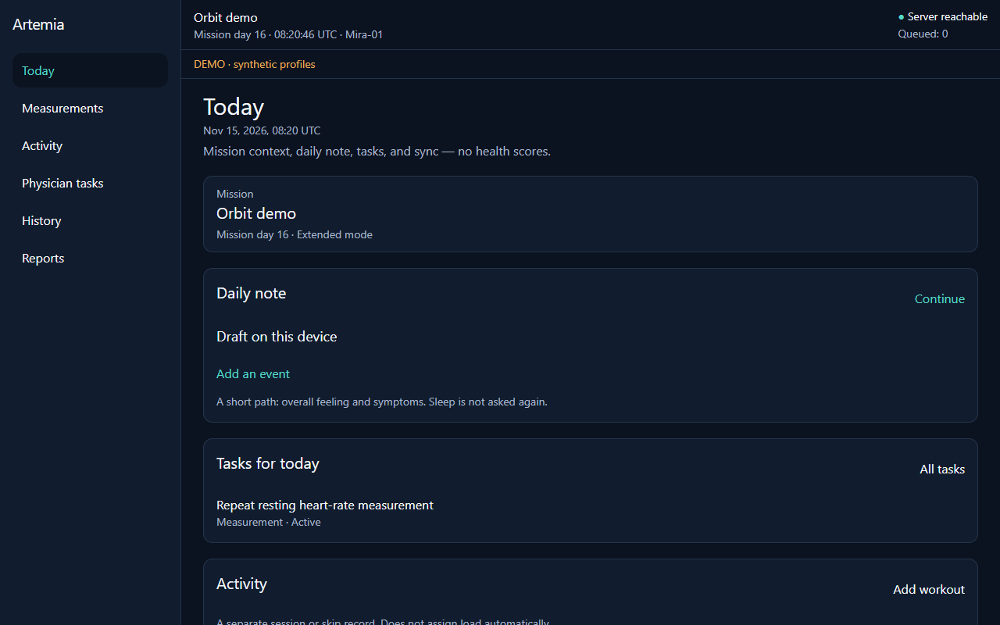
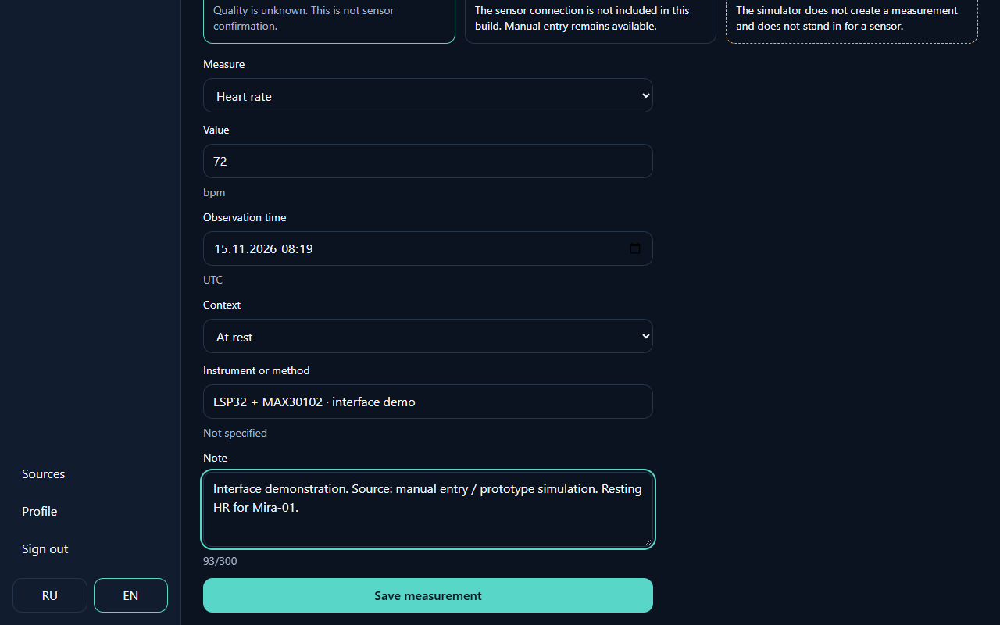
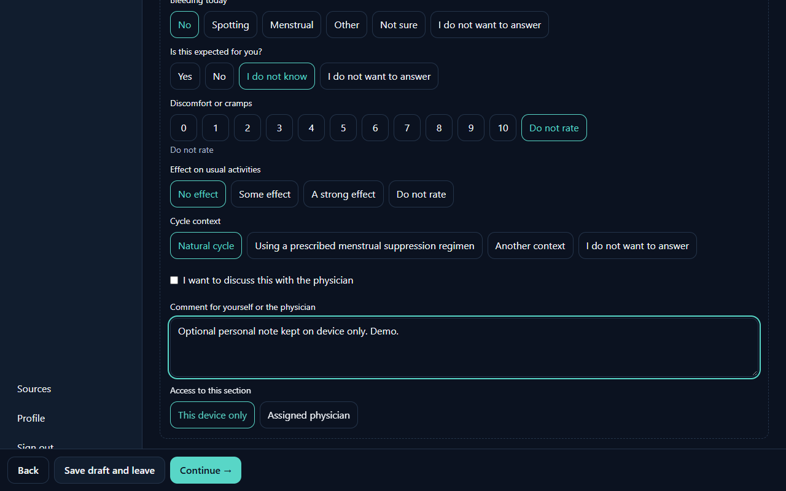
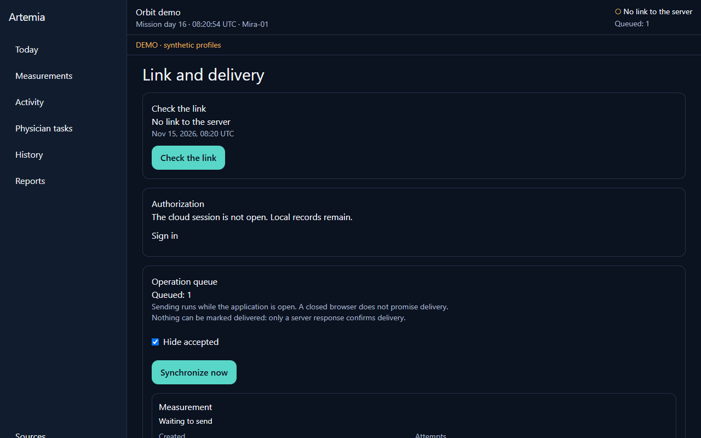
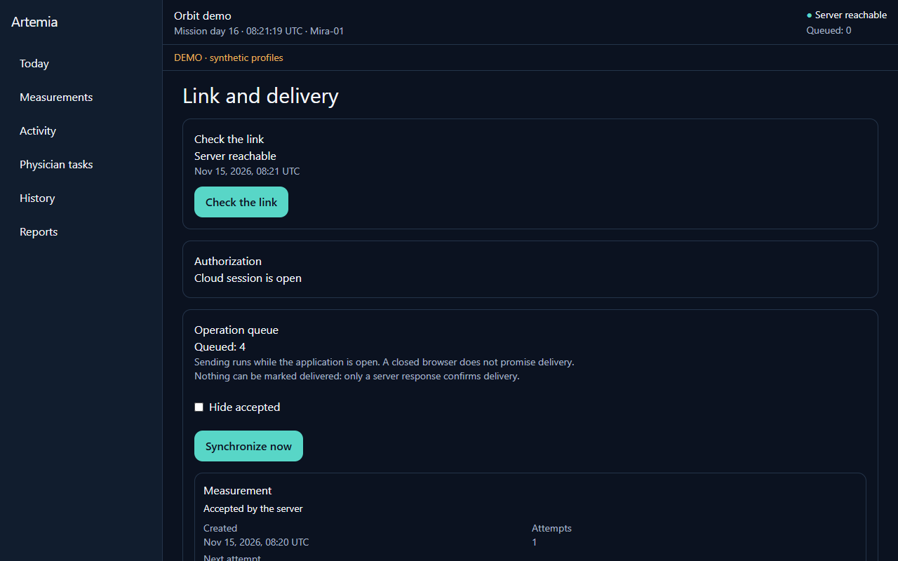
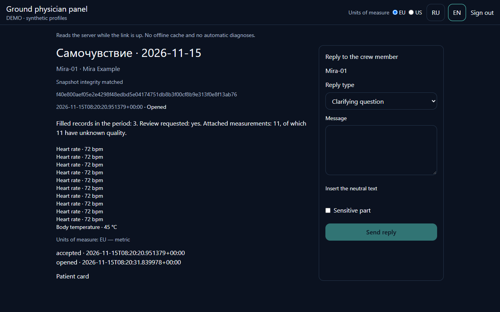
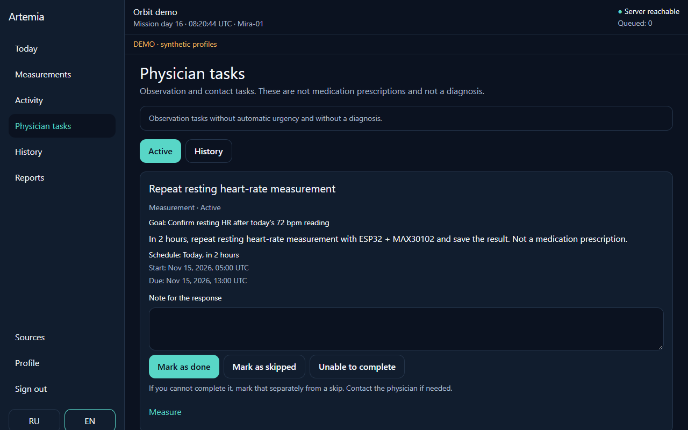

# Artemia

Crew health observation under limited connectivity. Astronauts record check-ins and measurements on the device first; assigned physicians review delivered reports and send observation tasks. The app does **not** diagnose or prescribe medication.

Demo mission: **Orbit demo · ORBIT-DEMO-01** · callsigns **Mira-01** / **Flight-Doc**.

## What you get

| Role | What it does |
|---|---|
| Astronaut | Daily check-in, optional personal section, USB or manual pulse, offline queue, physician tasks |
| Physician | Inbox of reports, patient snapshot, replies, observation plans (care tasks) |

Local-first: IndexedDB + outbox on the laptop; PostgreSQL + FastAPI when the link is up.

## Screenshots

Presentation captures live in [`docs/presentation-screenshots/`](docs/presentation-screenshots/). Suggested demo order:

| # | File | Story beat |
|---|---|---|
| 1 |  | Astronaut home — mission day, tasks, check-in |
| 2 |  | Heart-rate measurement (ESP32 demo / USB) |
| 3 |  | Optional personal health — private by default |
| 4 |  | No link — record waiting in the queue |
| 5 |  | Link restored — accepted by the server |
| 6 |  | Physician opens the report |
| 7 |  | Observation task on the astronaut device |

Recapture (with API + Vite running):

```bash
# from repository root
node scripts/capture_presentation_screenshots.mjs
```

## Repository layout

```text
Artemia-NASA/                 ← run most commands from here
├── src/                      frontend (React + Vite + TypeScript)
├── backend/                  FastAPI + Alembic + seed
├── firmware/esp32_max30102_usb/   ESP32 + MAX30102 USB Serial firmware
├── docs/presentation-screenshots/ presentation PNGs
├── scripts/                  capture / helper scripts
├── docker-compose.yml        Postgres + API
└── .env.example              copy to .env
```

## Prerequisites

- **Node.js** 20+ and **Yarn** (Berry / Corepack is fine)
- **Docker Desktop** (API + Postgres)
- **Chrome or Edge** on desktop for Web Serial (USB sensor)
- Optional: **Arduino IDE** + Espressif ESP32 board package + SparkFun MAX3010x library

## 1. Configure environment

From the **repository root** (`Artemia-NASA/`):

```bash
cp .env.example .env
```

On Windows PowerShell:

```powershell
Copy-Item .env.example .env
```

Edit `.env` and set at least:

- `POSTGRES_PASSWORD` — URL-safe (no spaces, `@`, `:`, `/`, `?`, `#`)
- `TOKEN_SECRET` — long random string (32+ characters)
- `SEED_*_PASSWORD` — demo account passwords (required by Compose)

Frontend defaults in `.env`:

```env
VITE_ENVIRONMENT=demo
VITE_API_URL=http://localhost:8000
```

Seed emails in `.env.example` (override in `.env` if you change them):

| Role | Email (example) |
|---|---|
| Astronaut Mira-01 | `mira-01@demo.artemia.local` |
| Astronaut Alex-02 | `alex-02@demo.artemia.local` |
| Flight physician | `flight-doc@demo.artemia.local` |

Use the passwords you put in `.env`.

## 2. Start the API (Docker)

Still from the **repository root**:

```bash
docker compose up --build -d
```

Wait until healthy:

```bash
curl http://127.0.0.1:8000/health
# {"status":"ok"}
```

PowerShell:

```powershell
Invoke-WebRequest http://127.0.0.1:8000/health -UseBasicParsing
```

Useful Compose commands (same directory):

```bash
docker compose ps
docker compose logs api --tail 80
docker compose stop api      # simulate offline link
docker compose start api
docker compose down
```

## 3. Start the web app

From the **repository root**:

```bash
yarn install
yarn dev
```

Open **http://localhost:5173** in Chrome or Edge.

Language: use **EN** / **RU** in the UI (login page or astronaut sidebar).

### First astronaut login

1. Sign in as Mira.
2. Complete **Prepare device** (confirm profile, timezone UTC, load checks, **Start**).
3. You land on **Today**.

### Physician login

1. Sign in as Flight-Doc.
2. You land on the **Ground physician panel** (inbox).

## 4. Demo walkthrough (software)

1. **Today** — mission day, fill daily check-in, see physician tasks.
2. **Measurements** — manual entry and/or USB sensor (below).
3. **Reports** — prepare a report for the assigned physician after records are synced.
4. **Link and delivery** — outbox / synchronize.
5. As physician — open the report, reply, create an observation task on the patient card.
6. Back as Mira — **Physician tasks** shows the new plan.

Offline story: stop the API container, save a measurement, open **Link and delivery** (queued), start API again, **Synchronize now**.

## 5. Hardware: ESP32 + MAX30102 (USB, no web server)

Detailed firmware notes: [`firmware/esp32_max30102_usb/README.md`](firmware/esp32_max30102_usb/README.md).

### Wiring (3.3 V only)

| MAX30102 | ESP32 |
|---|---|
| VIN / VCC | 3.3 V |
| GND | GND |
| SDA | **GPIO 8** |
| SCL | **GPIO 9** |

Do **not** power the sensor from 5 V.

### Flash

1. Open `firmware/esp32_max30102_usb/esp32_max30102_usb.ino` in Arduino IDE.
2. Board: ESP32 Dev Module (or your ESP32-S3 / matching board).
3. Library: **SparkFun MAX3010x Pulse and Proximity Sensor Library**.
4. Upload at the usual USB port. Baud for the app protocol: **115200**.

There is **no Wi‑Fi HTTP server** on the board — only USB Serial JSON Lines.

### Use in the app

1. Plug the ESP32 into the laptop.
2. Open **http://localhost:5173** → sign in as Mira → **Measurements**.
3. Choose **USB sensor** → **Connect** → pick the ESP32 COM port.
4. **Start measurement**, keep a finger still on the sensor (~30 s).
5. Review quality → **Save result** (`source=usb`).

If Web Serial is missing (unsupported browser), the UI keeps **manual** entry available.

## 6. Tests & build

From the **repository root**:

```bash
yarn test
yarn build
```

Backend tests (optional), from `backend/` with a venv and test database as used in CI/local scripts.

## Important limits

- Synthetic / demo profiles only — not clinical care.
- MAX30102 path is for **pulse / PPG** demonstration; SpO₂ is not claimed as validated.
- PPG chart label: optical signal — **not ECG**.
- “Viewed by physician” appears only after the physician really opens a report.

## How this project was built

- **Human-led:** product idea, architecture, domain rules, UX skeleton, and overall direction were defined by people.
- **AI-assisted (application):** parts of the implementation were written and iterated with **Cursor Agent** (code generation, refactors, wiring, tests, and tooling).
- **AI-assisted (presentation):** some presentation assets and slide-oriented screenshots were prepared with AI help; the narrative frame and what to show remain human-defined.

AI was a co-pilot, not a substitute for engineering judgment or demo ownership.

## License / context

Prototype for a NASA Space Apps–style demonstration of resilient crew observation under constrained links.
